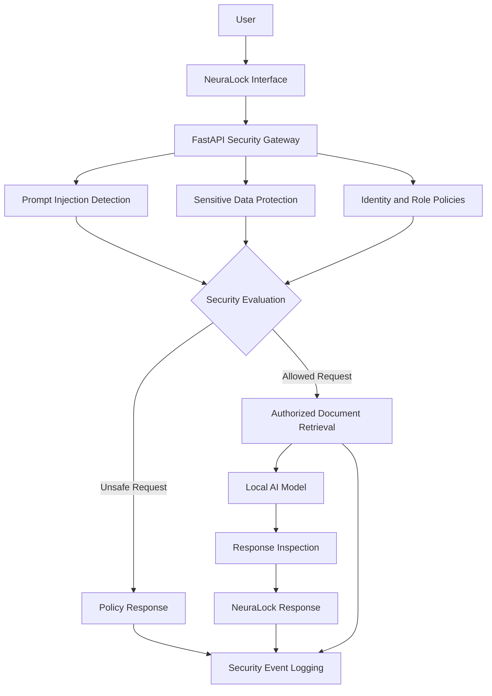

# 🔐 NeuraLock
### Secure the Prompt. Protect the Intelligence.

**Created by Vedhikanataraj**

*A Local AI Security Gateway for Prompt Injection Detection, Sensitive Data Protection and Role-Based Knowledge Access.*

**GitHub Repository:** NeuraLock

NeuraLock is a local AI security gateway that acts as a protective layer between users and AI models. It inspects incoming messages for prompt injection attempts and sensitive information, enforces document access policies, and controls the context supplied to the AI model.

Unlike a conventional chatbot, NeuraLock focuses on securing the AI interaction pipeline before information reaches the model.

---

## 🚨 The Problem

As organizations increasingly integrate AI into their workflows, they face security risks such as:

- **Prompt Injection:** Malicious instructions attempting to override an AI system's intended behaviour.
- **Sensitive Data Exposure:** Accidental disclosure of emails, credentials and confidential information.
- **Unauthorized Knowledge Access:** AI responses using documents that a user should not be permitted to access.
- **Insufficient Security Visibility:** Lack of traceability into security decisions made during AI interactions.

NeuraLock addresses these risks through a security gateway that inspects requests, applies access policies and records security events.

## 💡 Our Solution

NeuraLock introduces a security layer between the user and the local AI model.

Every chat request passes through security checks before reaching the model. The gateway evaluates suspicious instructions, detects sensitive information, retrieves only documents permitted for the configured role, and inspects the generated response before returning it.

### Core Features

| Feature | Description |
|---|---|
| Prompt Injection Detection | Identifies suspicious instructions using rule-based detection. |
| Sensitive Data Protection | Detects and redacts supported private information. |
| Role-Based Document Access | Restricts knowledge retrieval according to configured roles. |
| Context Isolation | Supplies only authorized active documents to the AI model. |
| Response Inspection | Checks generated responses for unsafe content and sensitive information. |
| Security Event Logging | Records security decisions and relevant event details. |
| Local LLM Integration | Supports communication with a locally hosted model through an API-compatible endpoint. |
| Graceful Fallback | Keeps the chat workflow available when the local model is unavailable. |

## 🏗️ System Architecture

NeuraLock uses a gateway-based architecture.



### Request Processing Workflow

1. The user submits a message through the NeuraLock interface.
2. The FastAPI gateway receives and inspects the request.
3. Prompt injection detection evaluates suspicious instructions.
4. Sensitive data protection identifies and redacts supported private information.
5. The server applies the configured identity and role policies.
6. Only active documents authorized for the current role are supplied as AI context.
7. The local model generates a response when available.
8. The response is inspected before being returned.
9. Security events are recorded for traceability.

## 🛠️ Technology Stack

| Layer | Technology |
|---|---|
| Backend | Python, FastAPI |
| API Documentation | Swagger / OpenAPI |
| Database | SQLite |
| ORM | SQLAlchemy |
| AI Integration | Ollama-compatible local API |
| Frontend | HTML, CSS, JavaScript |
| Testing | Pytest |
| Development Environment | Visual Studio Code |

## 🔑 Identity and Access Control

NeuraLock uses server-configured identity settings rather than accepting a user-supplied role in individual chat requests.

| Environment Variable | Default | Purpose |
|---|---|---|
| `NEURALOCK_ORGANISATION_ID` | `local` | Identifies the document library |
| `NEURALOCK_ROLE` | `admin` | Sets the gateway's configured role |
| `NEURALOCK_DATABASE_URL` | `sqlite:///./neuralock.db` | Configures the database |
| `NEURALOCK_LLM_BASE_URL` | `http://127.0.0.1:11434` | Local model API address |
| `NEURALOCK_LLM_MODEL` | `llama3.2` | Model identifier |

Supported roles:

- `employee`
- `manager`
- `admin`

Only the administrator can create, update and deactivate documents. Document retrieval and chat context are restricted to active documents whose allowed roles include the configured role.

The administrator role is retained when saving document permissions.

**Security note:** The current identity configuration is gateway-level. Individual user authentication and production-grade identity management are planned enhancements.

## 🚀 Getting Started

### Prerequisites

- Python installed
- Git
- Visual Studio Code (recommended)
- Ollama or another compatible local model endpoint (optional)

### 1. Clone the Repository

```bash
git clone https://github.com/Vedhikanataraj/NeuraLock.git
cd NeuraLock
```
### 2. Create a Virtual Environment

From the project root:

```powershell
python -m venv .venv
```

Activate it:

```powershell
.\.venv\Scripts\Activate.ps1
```

### 3. Install Dependencies

```powershell
python -m pip install -r backend/requirements.txt
```

### 4. Start the Backend

Navigate to the backend directory:

```powershell
cd backend
```

Start FastAPI:

```powershell
..\.venv\Scripts\python.exe -m uvicorn app.main:app --reload
```

### 5. Open NeuraLock

Open the local interface:

**http://127.0.0.1:8000/ui/**

API documentation:

**http://127.0.0.1:8000/docs**

If port 8000 is unavailable, use an alternative port:

```powershell
..\.venv\Scripts\python.exe -m uvicorn app.main:app --reload --port 8001
```

### 6. Configure the Local AI Model (Optional)

By default, NeuraLock uses:

```text
NEURALOCK_LLM_BASE_URL=http://127.0.0.1:11434
NEURALOCK_LLM_MODEL=llama3.2
```

Start your compatible local model service and configure these environment variables if you use a different endpoint or model.

NeuraLock can return a policy-based response when the model is unavailable.

## 🧪 Testing

NeuraLock includes automated tests for its chat security and document authorization workflows.

Run the test suite from the project root:

```powershell
cd backend
..\.venv\Scripts\python.exe -m pytest -v
```

### Current Test Results

**11 tests passed, 0 failed.**

Coverage includes:

- JSON security decision parsing.
- Unsafe answer handling.
- Sensitive email redaction.
- Chat continuity after a refused message.
- Behaviour when the local model is unavailable.
- Role-based document access.
- Prevention of unauthorized document creation.
- Authorized document context retrieval.
- Secret redaction in generated responses.
- Prevention of document retrieval following injection attempts.
- Exclusion of deactivated documents.

## 📁 Project Structure

```text
NeuraLock/
│
├── backend/
│   ├── app/
│   │   ├── security/
│   │   │   ├── data_protection.py
│   │   │   └── prompt_detector.py
│   │   ├── chatbot.py
│   │   ├── db.py
│   │   ├── main.py
│   │   ├── models.py
│   │   └── settings.py
│   │
│   ├── tests/
│   └── requirements.txt
│
├── frontend/
│   └── index.html
│
├── ml/
│   └── inspect_dataset.py
│
├── docs/
├── .gitignore
└── README.md
```

## 🗺️ Development Roadmap

NeuraLock is under active development.

### Phase 1 — Security Foundation
- [x] FastAPI security gateway
- [x] SQLite database integration
- [x] Rule-based prompt injection detection
- [x] Sensitive data detection and redaction
- [x] Role-based document authorization
- [x] Security event logging
- [x] Automated security tests

### Phase 2 — Machine Learning Detection
- [ ] Prepare and label prompt injection datasets
- [ ] Develop an ML-based prompt classifier
- [ ] Evaluate precision, recall and F1-score
- [ ] Analyse false-positive and false-negative rates
- [ ] Integrate the classifier into the security pipeline

### Phase 3 — Advanced AI Gateway
- [ ] Improve request and response inspection
- [ ] Strengthen policy enforcement
- [ ] Expand model compatibility
- [ ] Introduce advanced security analytics

### Phase 4 — Authentication and Production Security
- [ ] Individual user authentication
- [ ] Stronger identity and organization isolation
- [ ]