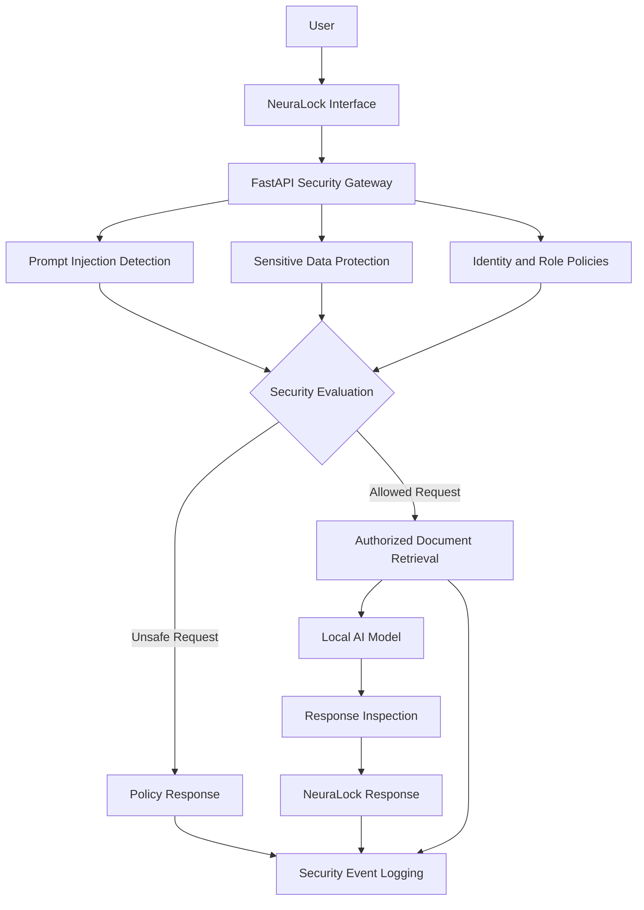

# 🔐 NeuraLock
### Secure the Prompt. Protect the Intelligence.

**Created by Vedhikanataraj**

*A Local AI Security Gateway for Prompt Injection Detection, Sensitive Data Protection and Role-Based Knowledge Access.*

**GitHub Repository:** NeuraLock

NeuraLock is a local AI security gateway that acts as a protective layer between users and AI models. It inspects incoming messages for prompt injection attempts and sensitive information, enforces document access policies, and controls the context supplied to the AI model.

Unlike a conventional chatbot, NeuraLock focuses on securing the AI interaction pipeline before information reaches the model.

---

## 🚨 The Problem

As organizations increasingly integrate AI into their workflows, they face security risks such as:

- **Prompt Injection:** Malicious instructions attempting to override an AI system's intended behaviour.
- **Sensitive Data Exposure:** Accidental disclosure of emails, credentials and confidential information.
- **Unauthorized Knowledge Access:** AI responses using documents that a user should not be permitted to access.
- **Insufficient Security Visibility:** Lack of traceability into security decisions made during AI interactions.

NeuraLock addresses these risks through a security gateway that inspects requests, applies access policies and records security events.

## 💡 Our Solution

NeuraLock introduces a security layer between the user and the local AI model.

Every chat request passes through security checks before reaching the model. The gateway evaluates suspicious instructions, detects sensitive information, retrieves only documents permitted for the configured role, and inspects the generated response before returning it.

### Core Features

| Feature | Description |
|---|---|
| Prompt Injection Detection | Identifies suspicious instructions using rule-based detection. |
| Sensitive Data Protection | Detects and redacts supported private information. |
| Role-Based Document Access | Restricts knowledge retrieval according to configured roles. |
| Context Isolation | Supplies only authorized active documents to the AI model. |
| Response Inspection | Checks generated responses for unsafe content and sensitive information. |
| Security Event Logging | Records security decisions and relevant event details. |
| Local LLM Integration | Supports communication with a locally hosted model through an API-compatible endpoint. |
| Graceful Fallback | Keeps the chat workflow available when the local model is unavailable. |

## 🏗️ System Architecture

NeuraLock uses a gateway-based architecture.



### Request Processing Workflow

1. The user submits a message through the NeuraLock interface.
2. The FastAPI gateway receives and inspects the request.
3. Prompt injection detection evaluates suspicious instructions.
4. Sensitive data protection identifies and redacts supported private information.
5. The server applies the configured identity and role policies.
6. Only active documents authorized for the current role are supplied as AI context.
7. The local model generates a response when available.
8. The response is inspected before being returned.
9. Security events are recorded for traceability.

## 🛠️ Technology Stack

| Layer | Technology |
|---|---|
| Backend | Python, FastAPI |
| API Documentation | Swagger / OpenAPI |
| Database | SQLite |
| ORM | SQLAlchemy |
| AI Integration | Ollama-compatible local API |
| Frontend | HTML, CSS, JavaScript |
| Testing | Pytest |
| Development Environment | Visual Studio Code |

## Identity and Access Control

NeuraLock now uses individual accounts and expiring bearer sessions. On first launch, the UI prompts you to create the initial administrator account. Organisation IDs use `NL` followed by four digits (`NL0001` through `NL9999`); first-run setup defaults to `NL0001`. Use a unique username and a password of at least 12 characters. Administrators can create employee, manager, and admin accounts from the UI. Passwords are stored as PBKDF2 hashes, and session tokens expire after 12 hours.

| Environment Variable | Default | Purpose |
|---|---|---|
| `NEURALOCK_DATABASE_URL` | `sqlite:///./neuralock.db` | Configures the database |
| `NEURALOCK_LLM_BASE_URL` | `http://127.0.0.1:11434` | Local model API address |
| `NEURALOCK_LLM_MODEL` | `llama3.2` | Model identifier |

Supported roles:

- `employee`
- `manager`
- `admin`

Only administrators can create, update and deactivate documents. Document retrieval and chat context are restricted to active documents in the signed-in user's organisation whose allowed roles include that user's server-side role. Chat history and event views are scoped to the signed-in user; administrators can view security events for their organisation.

The administrator role is retained when saving document permissions.

**Local deployment note:** Keep the development server bound to localhost. The built-in in-memory rate limiter is intended for local use; a shared persistent limiter and production deployment review are still needed before exposing the gateway to a network.

## 🚀 Getting Started

### Prerequisites

- Python installed
- Git
- Visual Studio Code (recommended)
- Ollama or another compatible local model endpoint (optional)

### 1. Clone the Repository

```bash
git clone https://github.com/Vedhikanataraj/NeuraLock.git
cd NeuraLock
```
### 2. Create a Virtual Environment

From the project root:

```powershell
python -m venv .venv
```

Activate it:

```powershell
.\.venv\Scripts\Activate.ps1
```

### 3. Install Dependencies

```powershell
python -m pip install -r backend/requirements.txt
```

### 4. Start the Backend

Navigate to the backend directory:

```powershell
cd backend
```

Start FastAPI:

```powershell
..\.venv\Scripts\python.exe -m uvicorn app.main:app --reload
```

### 5. Open NeuraLock

Open the local interface:

**http://127.0.0.1:8000/ui/**

API documentation:

**http://127.0.0.1:8000/docs**

If port 8000 is unavailable, use an alternative port:

```powershell
..\.venv\Scripts\python.exe -m uvicorn app.main:app --reload --port 8001
```

### 6. Configure the Local AI Model (Optional)

By default, NeuraLock uses:

```text
NEURALOCK_LLM_BASE_URL=http://127.0.0.1:11434
NEURALOCK_LLM_MODEL=llama3.2
```

Start your compatible local model service and configure these environment variables if you use a different endpoint or model.

NeuraLock can return a policy-based response when the model is unavailable.

On the first visit to `/ui/`, create the initial administrator. After signing in, administrators can create user accounts in the **Create user** panel.

## 🧪 Testing

NeuraLock includes automated tests for its chat security and document authorization workflows.

Run the test suite from the project root:

```powershell
cd backend
..\.venv\Scripts\python.exe -m pytest -v
```

### Recorded Test Results

The last recorded result before the authentication and ownership changes was **11 tests passed, 0 failed**. The test suite has not yet been adapted or rerun against the new authenticated API.

Coverage includes:

- JSON security decision parsing.
- Unsafe answer handling.
- Sensitive email redaction.
- Chat continuity after a refused message.
- Behaviour when the local model is unavailable.
- Role-based document access.
- Prevention of unauthorized document creation.
- Authorized document context retrieval.
- Secret redaction in generated responses.
- Prevention of document retrieval following injection attempts.
- Exclusion of deactivated documents.

## 📁 Project Structure

```text
NeuraLock/
│
├── backend/
│   ├── app/
│   │   ├── security/
│   │   │   ├── data_protection.py
│   │   │   └── prompt_detector.py
│   │   ├── chatbot.py
│   │   ├── auth.py
│   │   ├── db.py
│   │   ├── main.py
│   │   ├── models.py
│   │   └── settings.py
│   │
│   ├── tests/
│   └── requirements.txt
│
├── frontend/
│   └── index.html
│   └── app.js
│
├── ml/
│   ├── inspect_dataset.py
│   └── evaluate_security.py
│
├── docs/
├── .gitignore
└── README.md
```

## Development Roadmap

NeuraLock is under active development. The roadmap below separates implemented capabilities from planned work.

### Phase 1 — Security Foundation
- [x] FastAPI security gateway
- [x] SQLite database integration
- [x] Rule-based prompt injection detection
- [x] Sensitive data detection and redaction
- [x] Role-based document authorization
- [x] Security event logging
- [x] Automated security tests

### Phase 2 — Security Evaluation and Detection
- [ ] Build a labeled evaluation set for direct and indirect prompt injection, sensitive data, and safe requests.
- [x] Add a JSONL evaluation utility that reports precision, recall, F1-score, and false-positive rate for prompt injection detection.
- [x] Expand injection and sensitive-data coverage beyond the initial regex patterns.
- [ ] Add adversarial evaluation for obfuscation, multilingual prompts, and malicious instructions embedded in documents.
- [ ] Consider an ML-based classifier after establishing reproducible evaluation baselines.

### Phase 3 — Authentication and Data Ownership
- [x] Add individual user authentication and expiring session management.
- [x] Associate conversations and security events with their owning user and organisation.
- [x] Enforce ownership checks on chat history and user-specific event views.
- [x] Replace the shared environment-level role with authenticated, server-verified roles.
- [ ] Add authorization tests for cross-user and cross-organisation access.

### Phase 4 — Safer Knowledge Retrieval
- [x] Retrieve only relevant documents from the user's authorized active documents.
- [x] Preserve role and organisation authorization before retrieval and before adding content to model context.
- [x] Include document IDs and titles in the model context and decision metadata.
- [x] Reject document content with hidden formatting marks or known suspicious instruction patterns.
- [ ] Add tests for poisoned documents, stale permissions, and cross-organisation retrieval.

### Phase 5 — Output and Service Hardening
- [x] Validate model response actions and keep generated content rendered as text in the browser.
- [x] Add per-client request throttling, bounded model timeouts, and response security headers.
- [x] Avoid logging raw prompts and redact supported sensitive patterns in model context and responses.
- [ ] Add a shared rate limiter and production deployment settings before network exposure.

### Phase 6 — Security Dashboard and Operations
- [x] Add event filters for risk level and action, with user or organisation scoping.
- [x] Add event summaries for high-risk events, redactions, and refusals while avoiding raw prompt storage.
- [ ] Add detector performance and model availability trends over time.
- [ ] Add export and retention controls for authorized administrators.
